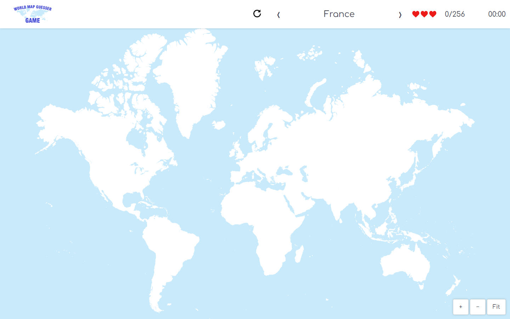

  

  <h1>World Map Guesser</h1>

  
Three lives. A whole world to explore.

  
Find countries on an interactive map, test your geography, and see how far you can go.

  

    <a href="https://wmg.darkboy.at/"><strong>Play now →</strong></a>
    &nbsp; · &nbsp;
    <a href="#how-to-play">How to play</a>
    &nbsp; · &nbsp;
    <a href="#controls">Controls</a>
  

  
No download or account needed. Pick a nickname and start exploring.

## The world is your challenge

- **256 countries and territories.** Explore the full map, from familiar outlines to tiny islands.
- **A different order every game.** Prompts are shuffled, so each attempt takes a new route around the world.
- **Learn as you play.** Correct answers turn green; after a mistake, the country you were looking for turns red.
- **Play with a mouse or touch.** Pan across continents and zoom in on the smallest places.
- **Aim for the top 10.** Compare your score and time, then explore the answer maps behind leaderboard entries.

## How to play

1. Open [World Map Guesser](https://wmg.darkboy.at/), enter a nickname, and select **START**.
2. Read the country name at the top and click or tap its location on the map.
3. Earn one point for each correct answer. A wrong answer costs one of your three lives and reveals the requested country in red.
4. Unsure where to look? Use the arrows to move between unanswered prompts without losing a life.
5. Get through all 256 prompts with lives remaining to win. The third mistake ends the game.

Your score and elapsed time appear when the game ends. Select **RESTART** for another attempt.

## Controls

| Action | Mouse and keyboard | Touch |
| --- | --- | --- |
| Answer | Click a country | Tap a country |
| Move the map | Click and drag | Drag with one finger |
| Zoom | Scroll, or use **+** / **−** | Pinch, or use **+** / **−** |
| Return to the full map | Select **Fit** | Tap **Fit** |
| Change the prompt | **←** / **→** keys or the arrows beside the country name | Tap the arrows beside the country name |

Dragging and zooming move the map without submitting an answer. Zoom in whenever a small territory is hard to select.

## Climb the leaderboard

The leaderboard shows the **top 10 results**, with higher scores first and faster times breaking ties. Open an entry's map preview to see its correct answers in green and mistakes in red.

Challenge yourself to recognize one more country, beat your best time, or make it through the whole map.

---

Ready to test your geography? **[Play World Map Guesser →](https://wmg.darkboy.at/)**

Development, architecture, and testing guides are in the [developer documentation](docs/README.md).
